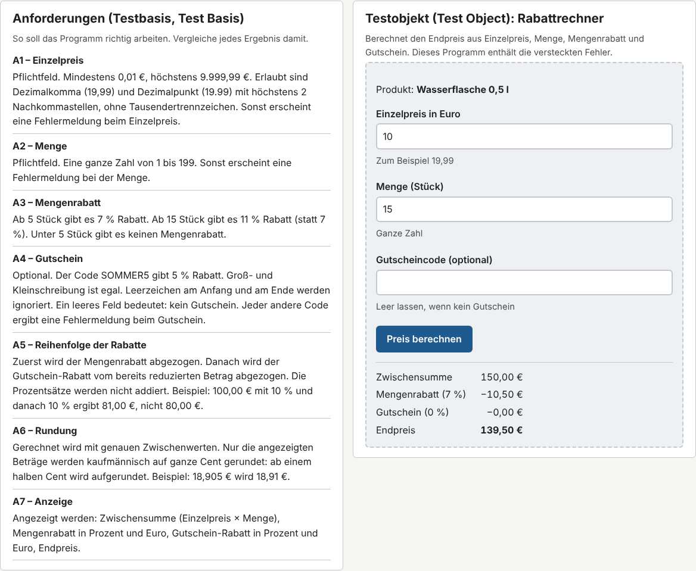
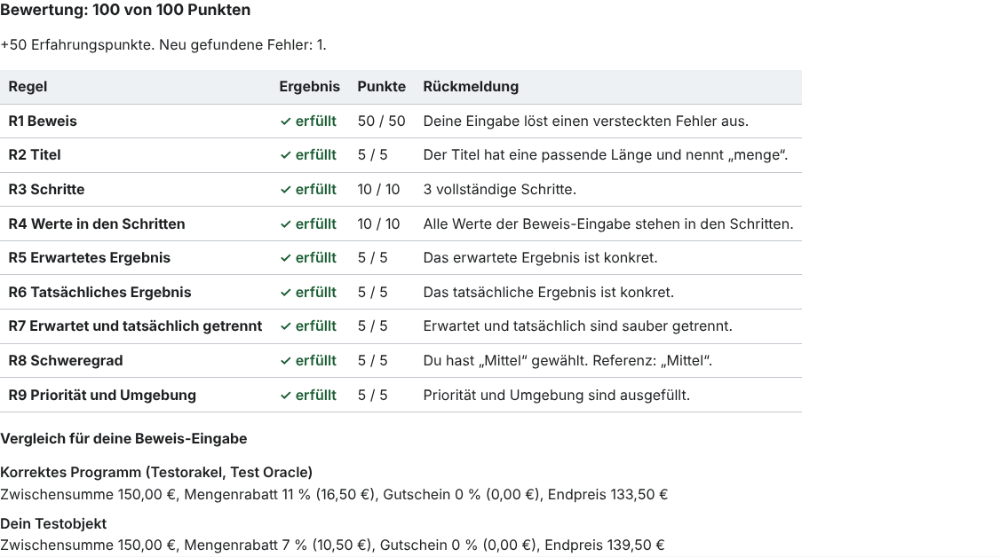
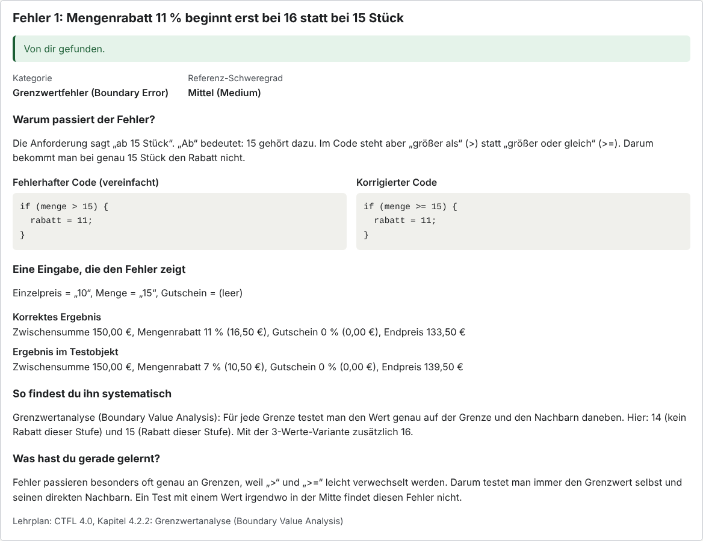
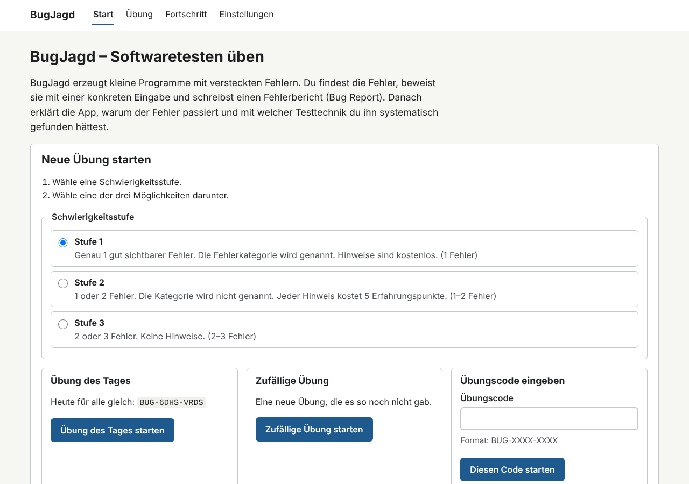
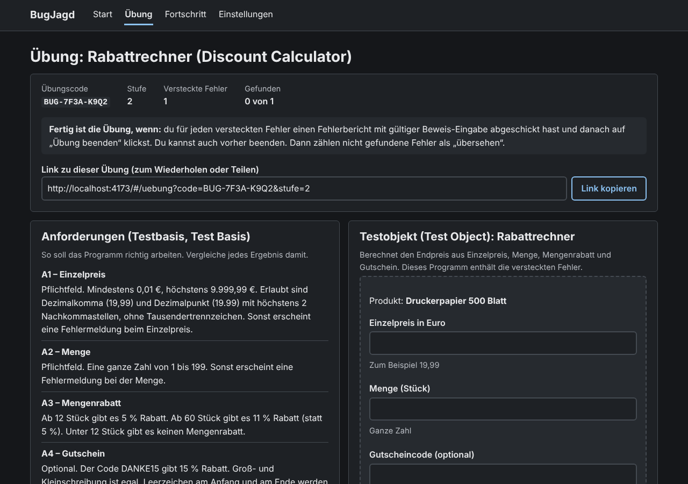

# BugJagd

**Deutsch** · [English](#english)

BugJagd ist eine Lern-Web-App für Softwaretesten. Sie erzeugt kleine Programme mit versteckten Fehlern.
Du findest die Fehler, beweist sie mit einer konkreten Eingabe und schreibst einen Fehlerbericht.
Danach erklärt die App, warum der Fehler passiert und mit welcher Testtechnik du ihn systematisch gefunden hättest.
Die Inhalte orientieren sich am Lehrplan **ISTQB Certified Tester Foundation Level (CTFL) v4.0**.

- Läuft komplett im Browser. Kein Server, keine Anmeldung, kein Tracking, keine Kosten.
- Jede Übung hat einen Code wie `BUG-7F3A-K9Q2`. Gleicher Code und gleiche Stufe ergeben immer die gleiche Übung.
- Die Beweis-Eingabe wird automatisch geprüft. Der Fehlerbericht wird mit 9 offenen, festen Regeln bewertet.
- Ruhige Oberfläche: keine Animationen, keine Geräusche, keine Pop-ups. Hell/Dunkel und 4 Schriftgrößen.

**Online-Version:** <https://otek69.github.io/BugJagd/> (noch nicht veröffentlicht – siehe [Stand](#stand))

## Screenshots

| Übung: Anforderungen und Testobjekt   | Bewertung des Fehlerberichts                 |
| ------------------------------------- | -------------------------------------------- |
|  |  |

| Lösung mit Erklärung                    | Startseite                           | Dunkles Design                         |
| --------------------------------------- | ------------------------------------ | -------------------------------------- |
|  |  |  |

## Starten (2 Befehle)

Voraussetzung: [Node.js](https://nodejs.org/) ab Version 20 ist installiert.

```bash
npm install
npm run dev
```

Danach zeigt das Terminal eine Adresse (meist <http://localhost:5173/>). Öffne sie im Browser.

## Weitere Befehle

| Befehl                | Was er tut                                                                                                  |
| --------------------- | ----------------------------------------------------------------------------------------------------------- |
| `npm test`            | Führt alle Unit-Tests aus (Vitest).                                                                         |
| `npm run e2e`         | Führt die End-to-End-Tests im Browser aus (Playwright). Einmalig vorher: `npx playwright install chromium`. |
| `npm run lint`        | Prüft den Code auf typische Fehler (ESLint).                                                                |
| `npm run typecheck`   | Prüft die Typen (TypeScript).                                                                               |
| `npm run build`       | Baut die fertige App in den Ordner `dist/`.                                                                 |
| `npm run screenshots` | Erzeugt die Screenshots in `docs/screenshots/` neu.                                                         |
| `npm run check`       | Lint, Typprüfung, Unit-Tests und Build nacheinander.                                                        |

## Stand

Version 0.1 – siehe [CHANGELOG.md](CHANGELOG.md).

- Mini-App: Rabattrechner (Discount Calculator)
- 5 Fehlerarten: Grenzwertfehler, fehlende Eingabeprüfung, falsche Rundung, Rabatte addiert statt nacheinander, Dezimalkomma
- Übungsart 1: Erkunden & Fehler melden, mit Beweis-Eingabe
- Stufen 1–3, Übungscodes, Übung des Tages, Fortschritt mit Export/Import

Die Online-Version wird automatisch veröffentlicht, sobald das Repository öffentlich ist und GitHub Pages eingeschaltet ist
(Settings → Pages → Source: „GitHub Actions“).

## Für Entwickler

- Architektur, Entscheidungen und Regeln: [AGENTS.md](AGENTS.md)
- Neue Fehlerart hinzufügen: [docs/ADDING_A_BUG.md](docs/ADDING_A_BUG.md)
- Neue Mini-App hinzufügen: [docs/ADDING_A_MINIAPP.md](docs/ADDING_A_MINIAPP.md)
- Projektverlauf: [docs/HISTORY.md](docs/HISTORY.md) · Plan: [docs/PLAN.md](docs/PLAN.md)

Lizenz: [MIT](LICENSE). Alle Texte sind eigene Formulierungen und keine Kopien offizieller ISTQB-Materialien.
ISTQB® ist eine eingetragene Marke des International Software Testing Qualifications Board. BugJagd ist kein offizielles ISTQB-Produkt.

---

## English

BugJagd ("bug hunt") is a learning web app for software testing. It generates small programs with hidden defects.
You find the defects, prove them with a concrete reproducing input and write a bug report.
Afterwards the app explains why the defect happens and which test technique would have found it systematically.
The content follows the **ISTQB Certified Tester Foundation Level (CTFL) v4.0** syllabus. The user interface is German;
technical terms are shown in German and English.

- Runs entirely in the browser. No server, no login, no tracking, no costs.
- Every exercise has a seed code like `BUG-7F3A-K9Q2`. Same code and level always produce the same exercise.
- The reproducing input is verified automatically against a test oracle. Bug reports are graded by 9 transparent, fixed rules.
- Calm UI: no animations, no sounds, no pop-ups. Light/dark theme and 4 font sizes.

**Live version:** <https://otek69.github.io/BugJagd/> (not published yet)

### Run it (2 commands)

Requires [Node.js](https://nodejs.org/) 20 or newer.

```bash
npm install
npm run dev
```

### Quality

- Unit tests (Vitest) for the seeded generator, every bug type (each one is proven to trigger with its reproducing
  input and not without the defect, over 200 random variants), report grading rules and storage.
- End-to-end tests (Playwright) for the main user flows, including automated accessibility checks with axe-core.
- Plugin-style architecture: a new bug type is one file plus one test file; nothing else changes.
  See [docs/ADDING_A_BUG.md](docs/ADDING_A_BUG.md) (German).

Tech stack: Vite, React, TypeScript, zod, Vitest, Playwright, ESLint, Prettier, GitHub Actions, GitHub Pages.

License: [MIT](LICENSE). ISTQB® is a registered trademark of the International Software Testing Qualifications Board.
BugJagd is not an official ISTQB product.
